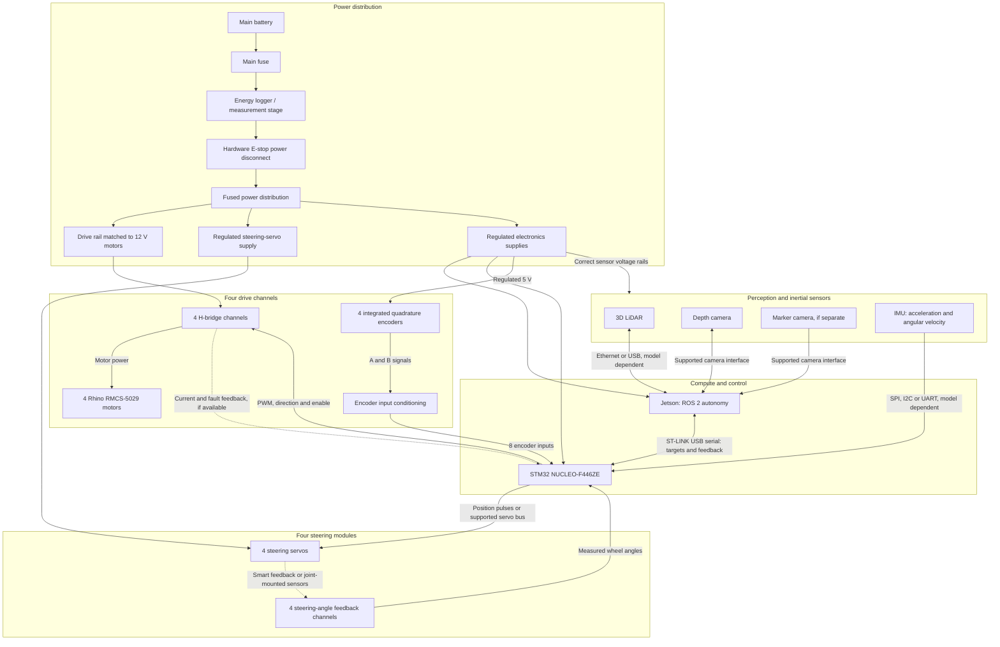

# Team Vritam Rover: Electrical and Control Architecture

This document describes the proposed wiring for Team Vritam's four-wheel-drive, independently steered rover. It separates power distribution from control and feedback, and defines the connection between the Jetson compute layer and STM32 actuator controller.

**Status:** architecture proposal, not an as-built schematic. Driver ratings, battery configuration, steering servos, sensor models, connector pinouts, wire sizes, and protection components remain to be finalised. No firmware or ROS implementation is included with this README.

## System overview

| Component | Quantity | Role |
| --- | --- | --- |
| Rhino RMCS-5029, 12 V, 30 RPM geared DC motor | 4 | Independent wheel propulsion |
| Integrated quadrature encoder | 4 | Wheel rotation feedback |
| Steering servo | 4 | Independent wheel steering |
| Steering-angle feedback channel | 4 | Actual wheel steering position |
| ST NUCLEO-F446ZE | 1 proposed | Encoder acquisition, drive-speed loops, steering supervision and watchdog |
| NVIDIA Jetson | 1, model TBD | ROS 2, perception, localisation, navigation and steering kinematics |
| 3D LiDAR | 1 planned | Terrain and obstacle observations |
| Depth camera | 1 planned | Nearby ground and crater-edge observations |
| Marker camera | If needed | Observe approved navigation markers |
| IMU | 1 planned | Accelerometer and gyroscope measurements |
| H-bridge motor driver channels | 4 | Bidirectional motor power control |

A Raspberry Pi is not required in this baseline. ROS 2 Humble is the software target; compatibility must be checked against the selected Jetson and JetPack installation.

## Wiring architecture

Solid arrows show proposed connections. Dashed arrows indicate optional or model-dependent feedback. Power-return conductors and connector pins are omitted; this is a functional wiring diagram.



USB cameras may receive power through their approved USB connection rather than a separate supply wire. Do not add a second power feed unless the sensor supports it. The diagram groups electronic supplies by function; it does not imply that every device uses the same voltage.

## Power distribution

| Branch | Loads | Design requirements |
| --- | --- | --- |
| Drive | Four H-bridge channels | Battery maximum voltage, current limiting, braking and regenerative energy handling |
| Steering | Four servos | Exact servo voltage and simultaneous peak steering current |
| Electronics | Jetson, MCU, encoders and sensors | Correct rails, transient protection and brownout prevention |

The PDB distributes power. The H-bridges control motor power. Neither replaces the other.

Use appropriately rated branch protection, conductors, connectors and regulators. Keep high-current motor returns out of encoder and logic signal-return paths. Follow the selected driver's grounding and isolation requirements.

The attached Caterpillar rulebook requires hardware power interruption independent of software and places energy monitoring before the kill switch. Implement the logger using its actual shunt/Hall-sensor and voltage-sense wiring instructions; the diagram does not specify high-side versus low-side shunt placement. Preserve logging when the E-stop operates. Confirm the final schematic against the inspection requirements, including any independently powered computer exception.

## Drive motors and encoders

Each motor requires its own independently controlled H-bridge channel. Two dual-channel drivers or four single-channel drivers can provide these channels.

The supplier lists 30,420 CPR, a 5 V encoder supply and up to 7.5 A load current for RMCS-5029. Confirm the CPR decoding convention and startup/stall-current requirements before sizing or programming the system. The listed current is not a verified stall-current rating.

### Supplier-listed motor harness

| Wire colour | Listed function | Intended destination |
| --- | --- | --- |
| Red | Motor minus | One H-bridge motor output |
| Black | Motor plus | Other H-bridge motor output |
| Blue | Encoder +5 V | Regulated encoder supply |
| Green | Encoder ground | Encoder reference, subject to supplier isolation requirements |
| White | Encoder A | Conditioned MCU encoder input |
| Yellow | Encoder B | Conditioned MCU encoder input |

Verify the delivered harness before connecting it. The listed motor colours are opposite the common red-positive convention. Both motor terminals are switched H-bridge outputs; neither is a permanent ground connection.

**Never connect encoder ground to a motor-output terminal.** Robokits states that encoder ground must be isolated from motor ground. Obtain clarification on the required isolation arrangement before completing the harness; separation of return wiring alone is not galvanic isolation.

The STM32 uses 3.3 V logic. Check encoder output type and voltage, then select suitable buffering/level conversion or explicitly compatible MCU inputs. A 5 V encoder supply does not establish safe signal voltage for every pin.

Use hardware timer encoder modes where practical. Allocate four encoder timers, drive PWM, servo outputs and communication peripherals together before assigning pins. Maintain accumulated wheel position as well as wheel velocity.

## Steering control and feedback

For ordinary PWM servos, provide a dedicated regulated servo rail and four control signals. Actual steering position requires feedback-capable servos or external steering-joint angle sensors. For smart servos, use the supported bus and transceiver; TTL, RS-485 and CAN devices are not interchangeable.

Calibrate servo position to actual wheel angle, including linkage geometry and zero offsets. Do not use commanded angle as measured feedback. Reduce or inhibit propulsion while steering error is excessive.

Servo current must not flow through the MCU board or Jetson USB connection. Ordinary servos already contain a position loop; the MCU commands and supervises that loop.

## Jetson to STM32 connection

Use a USB data cable from the Jetson to the Nucleo ST-LINK USB connector. Firmware communicates over the UART routed to the ST-LINK virtual COM port. Verify the selected board revision's UART routing, solder bridges and power jumpers in its manual.

On the Jetson, inspect persistent serial identifiers:

```bash
ls -l /dev/serial/by-id/
```

Use the persistent device path in configuration. Do not assume the board will always be `/dev/ttyACM0`.

Select the Nucleo power configuration to avoid backfeeding between external power and USB. USB supplies neither traction power nor steering power.

### Proposed communication contract

Use the same wheel order throughout: **front-left, front-right, rear-left, rear-right**.

| Direction | Fields |
| --- | --- |
| Jetson to MCU | Sequence number, enable state, four wheel velocity targets in rad/s, four steering targets in rad, integrity check |
| MCU to Jetson | Sequence number, acquisition timestamp, four accumulated wheel positions in rad, four wheel velocities in rad/s, four measured steering angles in rad, fault flags, E-stop status, available voltage/current measurements, integrity check |

Define packet framing, field widths, endianness, version, checksum/CRC, overflow behaviour and invalid-packet handling. Align MCU timestamps with the Jetson clock for odometry. Keep debug text out of the binary control stream.

Start by evaluating 50 Hz command and feedback exchange and a 200-500 Hz motor-speed loop. These are test targets, not fixed requirements. Select baud rate from packet size and bandwidth margin; use the servo manufacturer's supported command rate.

## ROS integration

The Jetson computes steering-aware wheel targets from the requested rover motion. The MCU handles actuator execution and measured feedback.

| Joint group | Command interface | State interfaces |
| --- | --- | --- |
| Four drive joints | Velocity | Position and velocity |
| Four steering joints | Position | Measured position; velocity if available |

A `ros2_control` hardware interface should send targets in `write()` and update states from received packets in `read()`. Keep serial operations bounded and nonblocking with respect to the control loop. This independently steered rover requires suitable kinematics; the ordinary differential-drive controller is not its drivetrain model.

## Sensors and competition constraints

Connect high-bandwidth LiDAR and camera data directly to the Jetson through the interfaces supported by the chosen models. In this baseline, the IMU connects to the MCU and its timestamped readings are forwarded to ROS in a defined telemetry message.

- Use LiDAR for terrain/obstacle coverage and the depth camera for nearby ground geometry.
- Calibrate sensor mounting transforms and synchronise observations.
- Exclude wall measurements before they contribute to autonomy, including free-space clearing.
- Keep unobserved ground distinct from traversable ground.
- Use only permitted IMU information; disable compass-derived orientation and GPS inputs.
- Observe approved markers for localisation corrections. Their exact placement must comply with the supplied rulebook.

## Fault handling and bring-up

The MCU must start with propulsion disabled, reject stale/corrupt commands, stop on communication timeout and require a deliberate re-enable after a fault. Evaluate timeout duration against actual loaded stopping distance. Hardware E-stop operation must not depend on ROS, USB or firmware.

Bring up one wheel module before replicating it:

1. Confirm voltage rails and pin assignments with actuators disconnected.
2. Test encoder counts, signal levels and polarity by rotating the wheel manually.
3. Test driver direction and current limiting on a current-limited supply.
4. Tune one wheel-speed loop and verify encoder feedback loss behaviour.
5. Calibrate steering angle, limits and feedback.
6. Verify Jetson command/feedback exchange and cable-disconnect stopping.
7. Replicate all four modules and test simultaneous steering/drive loads.
8. Validate braking, thermal behaviour, noise immunity and E-stop operation under representative load.

## Open engineering decisions

- [ ] Battery chemistry, capacity and fully charged voltage.
- [ ] Jetson model and compatible ROS/JetPack deployment.
- [ ] Driver model, continuous/peak current capability and braking behaviour.
- [ ] Encoder output circuit, CPR convention and supplier grounding clarification.
- [ ] Steering servo model, voltage, torque, range and feedback interface.
- [ ] LiDAR, camera and IMU models and power requirements.
- [ ] MCU timer/pin allocation and signal conditioning.
- [ ] Fuse, disconnect, regulator, wire and connector ratings.
- [ ] Energy logger wiring and inspection compliance.
- [ ] Validated control rates, communication timeout and loaded stopping distance.

## References

- [Robokits RMCS-5029 motor listing](https://robokits.co.in/motors/rhino-ig32-12v-20w-dc-motors/dc-servo-encoder-12v-motor/rhino-30rpm-70kgcm-12v-dc-planetary-geared-quad-encoder-servo-motor)
- [ST NUCLEO-F446ZE board documentation](https://www.st.com/en/evaluation-tools/nucleo-f446ze.html)
- [ROS 2 Humble: writing a ros2_control hardware component](https://control.ros.org/humble/doc/ros2_control/hardware_interface/doc/writing_new_hardware_component.html)
- Supplied Caterpillar Autonomy Challenge rulebook: PDF pages 3-4 for power/E-stop provisions, page 7 for navigation restrictions, and page 12 for navigation markers. The source PDF is not bundled with this README.
